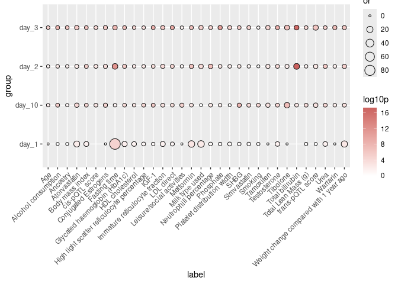

<!-- README.md is generated from README.Rmd. Please edit that file -->

# `prodente`: **Pro**tein **D**eterminants **En**richment **Te**sting

<!-- badges: start -->

[](https://github.com/comp-med/r-prodente/actions/workflows/R-CMD-check.yaml)
<!-- badges: end -->

Studying the plasma proteome in health and disease has now become feasible at scale, but most proteins that can be measured in blood do not have a function in blood. 
This implies that traditional pathway enrichment tools may give uninformative and maybe even misleading results when applied to lists of differentially expressed proteins from blood.
We used data from the UK Biobank (https://www.ukbiobank.ac.uk/) to systematically identify for each of >2,900 proteins what changes in plasma may represent, including >1,800 factors measured among >40,000 participants.
Using machine learning, we identified for each protein that most relevant factors, including diseases and drugs, enviromental components, but also lifestyl factors, or technical variables.

The goal of `prodente` is to make results from the publication
[`Machine learning-guided deconvolution of plasma protein levels`](https://doi.org/10.1101/2025.01.09.25320257)
immediately accessible and useful for **your study**. 

This package contains functions to
easily test a list of proteins for enrichment of UK Biobank study
characteristics. Analgous to pathway enrichment tools, the package delivers evidence for participant (patient) characteristics that may explain (some) of the differentially expressed proteins. 
For example, it provides a data-driven way to test for potential confounding by other treatments or preanalytical variables, such as platelet aggregation.

Please keep in mind, that this work is based on the Olink Explore platform, and that you need to 1) provide a background of all proteins measured in your study, and 2) that the Olink Explore platform may not capture all proteins available in your study or even have them measured to the same quality.

## Installation

You can install the development version of `prodente` directly from
GitHub:

``` r
library(remotes)
install_github("comp-med/prodente")
```

## Getting Started

The API consists only of a hand-full of functions that mostly make
working with the results table more convenient. Each important results
object is immediately available as accessible data.

``` r
library(prodente)

# There is example data provided
fasting_study_results <- prodente::fasting_study_results

# It is important to check that protein identifiers of your data are available
# in the background data.
check_protein_overlap(fasting_study_results$protein_id, return_missing = TRUE)
#> character(0)

# Make sure to check the provided mapping table in case you have missing
# proteins. Maybe they are in the data but formatted slightly differently.
# Additionally, the table provides Olink IDs and UniProt IDs to make matching 
# easier
head(prodente::protein_mapping_table)
#>    mapping_id           panel olink_id    assay uniprot hgnc_symbol
#>        <char>          <char>   <char>   <char>  <char>      <char>
#> 1:   adamts13 Cardiometabolic OID20249 ADAMTS13  Q76LX8    ADAMTS13
#> 2:      alcam Cardiometabolic OID20273    ALCAM  Q13740       ALCAM
#> 3:       blmh Cardiometabolic OID20336     BLMH  Q13867        BLMH
#> 4:        ca4 Cardiometabolic OID20241      CA4  P22748         CA4
#> 5:      casp3 Cardiometabolic OID20305    CASP3  P42574       CASP3
#> 6:      ccl15 Cardiometabolic OID20328    CCL15  Q16663       CCL15
```

Enrichment tests can be stratified by sex or genetic ancestry. Set the
`test_across` parameter of the function
`enrich_protein_characteristics()` to do so.

``` r
# Run enrichment tests for a list of proteins
results <- enrich_protein_characteristics(
  protein_foreground = fasting_study_results[group == "day_1", protein_id], 
  factor_minimum_explained_variance = 0, 
  test_across = "sex",
  n_cores = 8
  )


head(results[pval < 0.05 & or > 5, .(population, label)])
#>    population        label
#>        <char>       <char>
#> 1:        All      Insulin
#> 2:        All    Metformin
#> 3:     Female    Metformin
#> 4:       Male    Metformin
#> 5:       Male Bread intake
#> 6:        All Atorvastatin
```

Enrichment tests can also be performed across several groups. Use the
function `enrichment_test_across_groups()` for this.

``` r
# When data for several groups is available, supply a names list to this function
group_data <- list(
  day_1 = fasting_study_results[group == "day_1", protein_id],
  day_2 = fasting_study_results[group == "day_2", protein_id],
  day_3 = fasting_study_results[group == "day_3", protein_id],
  day_10 = fasting_study_results[group == "day_10", protein_id]
)

group_results <- enrichment_test_across_groups(
  protein_foreground_list = group_data, 
  test_across = "sex", 
  n_cores = 8
)

# You can plot enrichment results for a single subgroup (within either `sex` or `ancestry`)
enrichment_plot <- plot_enrichment_results(
  group_results,
  plot_population = "All"
)
```



### Accessing the data

To access the data provided in the package, use the
`prodente::<DATA_OBJECT>` notation.

``` r
fasting_study_results <- prodente::fasting_study_results
participant_characteristics_labels <- prodente::participant_characteristics_labels
protein_mapping_table <- prodente::protein_mapping_table
variance_decomposition_background <- prodente::variance_decomposition_background
```
