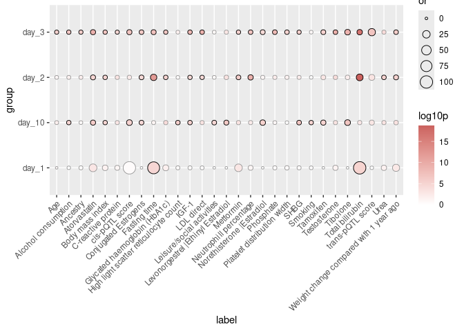
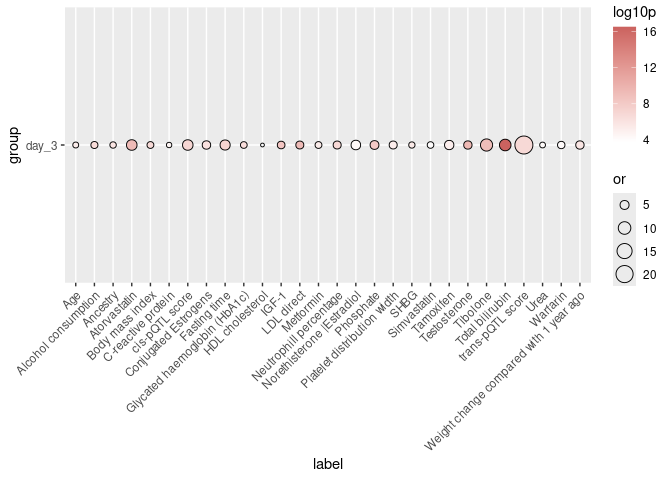

<!-- README.md is generated from README.Rmd. Please edit that file -->

# `prodente`: **Pro**tein **D**eterminants **En**richment **Te**sting

<!-- badges: start -->

[](https://github.com/comp-med/r-prodente/actions/workflows/R-CMD-check.yaml)
<!-- badges: end -->

The goal of `prodente` is to make results from the publication
[`Machine learning-guided deconvolution of plasma protein levels`](https://doi.org/10.1101/2025.01.09.25320257)
immediately accessible and useful. This package contains functions to
easily test a list of proteins for enrichment of UK Biobank study
characteristics. It uses Fisher’s exact test to assess enrichment of
input proteins (or groups of proteins) for explanatory characteristics
(e.g. diseases, drugs, genetics). The test can be stratified by sex or
ancestry.

## Installation

You can install the development version of `prodente` directly from
GitHub:

``` r
library(remotes)
install_github("comp-med/prodente")
```

## Getting Started

The API consists only of a hand-full of functions that mostly make
working with the results table more convenient. Each important results
object is immediately available as accessible data.

``` r
library(prodente)

# There is example data provided.
fasting_study_results <- prodente::fasting_study_results

# It is important to check that protein identifiers of your data are available
# in the background data.
check_protein_overlap(fasting_study_results$protein_id, return_missing = TRUE)
#> character(0)

# The input should be a vector of protein names in lowercase (or a list of
# vectors for enrichment tests across groups)

head(fasting_study_results$protein_id)
#> [1] "pcsk9"    "apoa4"    "lep"      "tmprss15" "fam3b"    "tnr"
# "pcsk9"    "apoa4"    "lep"      "tmprss15" "fam3b"    "tnr"
#
# Make sure to check the provided mapping table in case you have missing
# proteins. Maybe they are in the data but formatted slightly differently.
# Additionally, the table provides Olink IDs and UniProt IDs to make matching
# easier.
head(prodente::protein_mapping_table)
#>    mapping_id           panel olink_id    assay uniprot hgnc_symbol
#>        <char>          <char>   <char>   <char>  <char>      <char>
#> 1:   adamts13 Cardiometabolic OID20249 ADAMTS13  Q76LX8    ADAMTS13
#> 2:      alcam Cardiometabolic OID20273    ALCAM  Q13740       ALCAM
#> 3:       blmh Cardiometabolic OID20336     BLMH  Q13867        BLMH
#> 4:        ca4 Cardiometabolic OID20241      CA4  P22748         CA4
#> 5:      casp3 Cardiometabolic OID20305    CASP3  P42574       CASP3
#> 6:      ccl15 Cardiometabolic OID20328    CCL15  Q16663       CCL15
#>    mapping_id           panel olink_id    assay uniprot hgnc_symbol
#>        <char>          <char>   <char>   <char>  <char>      <char>
#> 1:   adamts13 Cardiometabolic OID20249 ADAMTS13  Q76LX8    ADAMTS13
#> 2:      alcam Cardiometabolic OID20273    ALCAM  Q13740       ALCAM
#> 3:       blmh Cardiometabolic OID20336     BLMH  Q13867        BLMH
#> 4:        ca4 Cardiometabolic OID20241      CA4  P22748         CA4
#> 5:      casp3 Cardiometabolic OID20305    CASP3  P42574       CASP3
#> 6:      ccl15 Cardiometabolic OID20328    CCL15  Q16663       CCL15
```

Enrichment tests can be stratified by sex or genetic ancestry. Set the
`test_across` parameter of the function
`enrich_protein_characteristics()` to do so.

``` r
# Run enrichment tests for a list of proteins
results <- enrich_protein_characteristics(
  protein_foreground = fasting_study_results[group == "day_3", protein_id],
  factor_minimum_explained_variance = 0,
  test_across = "sex",
  n_cores = 8
)

# The output is a data.table with enrichment results
head(results[p_adjust < 0.05 & or > 5, .(population, label)])
#>    population        label
#>        <char>       <char>
#> 1:     Female      Digoxin
#> 2:     Female  Simvastatin
#> 3:        All Atorvastatin
#> 4:     Female Atorvastatin
#> 5:        All Fasting time
#> 6:     Female Fasting time

# The results table contains the following columns:
#
# "population": The sex or ancestry group the enrichment was tested in
# "variable": The identifier of characteristic that was tested for enrichment
# "or": Odds ratio of the enrichment test
# "pval": P-value of the enrichment test
# "intersection": Proteins in both foreground and explained by the variable
# "d1" - "d4": Values in the 2x2 contingency table
# "category": Category of the variable (e.g. "Diseases", "Drugs", "Technical")
# "id": UK Biobank identifier of the characteristic
# "column_name": UK Biobank format identifier
# "label": Label of the characteristic, e.g. "Fasting time"
# "released": logical indicating if variable is released in the UK Biobank
# "type": Data type of the characteristic, e.g. "numeric", "factor"
# "category_sort": 
# "p_adjust": Bonferroni-adjusted p-value (within each population)
```

Enrichment tests can also be performed across several groups. Use the
function `enrichment_test_across_groups()` for this.

``` r
# When data for several groups is available, supply a names list to this function
group_data <- list(
  day_1 = fasting_study_results[group == "day_1", protein_id],
  day_2 = fasting_study_results[group == "day_2", protein_id],
  day_3 = fasting_study_results[group == "day_3", protein_id],
  day_10 = fasting_study_results[group == "day_10", protein_id]
)

group_results <- enrichment_test_across_groups(
  protein_foreground_list = group_data, 
  test_across = "sex", 
  n_cores = 8
)
```

Enrichment test output can be plotted using the function
`plot_enrichment_results()`.

``` r
# You can plot enrichment results for a single population (within either `sex`
# or `ancestry`).
enrichment_plot <- plot_enrichment_results(
  group_results,
  plot_population = "All"
)
```



``` r

# The plot function looks for a 'group' column in the results table, so if you
# want to plot results from enrich_protein_characteristics() function, first
# add a 'group' column to the results.
results$group <- "day_3"
enrichment_plot <- plot_enrichment_results(
  results,
  plot_population = "All"
)
```



### Accessing the data

To access the data provided in the package, use the
`prodente::<DATA_OBJECT>` notation.

``` r
fasting_study_results <- prodente::fasting_study_results
participant_characteristics_labels <- prodente::participant_characteristics_labels
protein_mapping_table <- prodente::protein_mapping_table
variance_decomposition_background <- prodente::variance_decomposition_background
```
